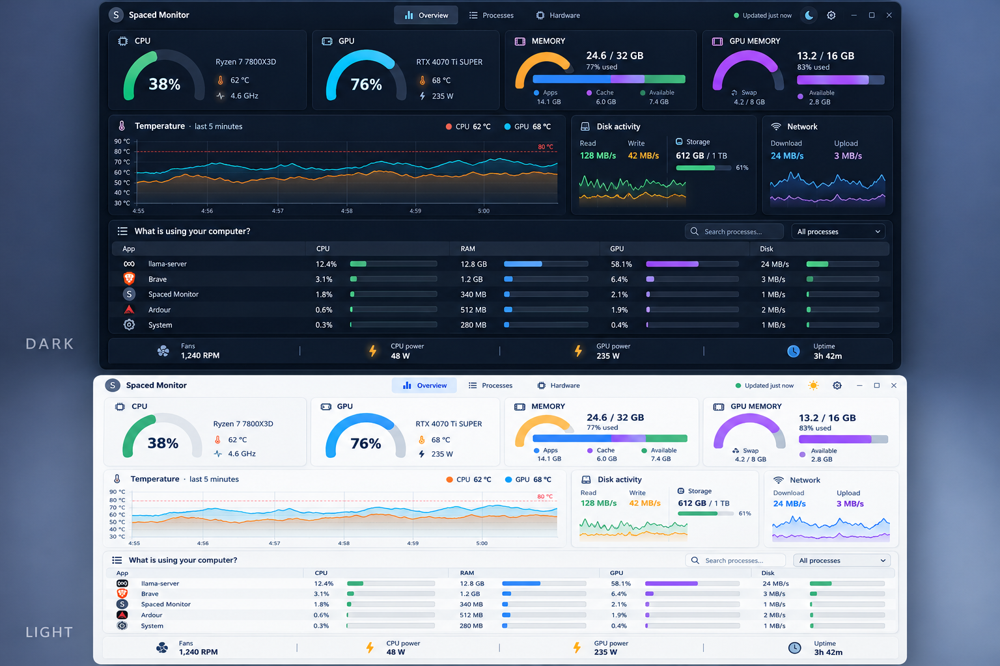

# Spaced Monitor

The system monitor for Spaced Linux: CPU, GPU, memory, temperatures, disks, network and
the programs using them, in one window that is easy to read at a glance. Rich colours on
the gauges, clear temperature graphs, dark and light themes.

Status: in development ([crhy/spaced#385](https://github.com/crhy/spaced/issues/385)).



## Planned

- **Overview**: CPU, GPU, memory and GPU-memory gauges; a five-minute CPU/GPU temperature
  graph; disk and network activity; "What is using your computer?" with per-program CPU,
  RAM, GPU and disk use, and a button to end a program; fans, CPU/GPU power and uptime.
- **Processes**: the full process list, searchable and sortable.
- **Hardware**: per-core, per-sensor and per-device detail.

Native Debian package (Python, GTK 3), shipped through the Spaced Linux APT repository.
No systemd. GPL-3.0-or-later.

## Install

Build the package (see Build below), then install it with apt:

```sh
sudo apt install ./build/spaced-monitor_*.deb
```

## Run

```sh
spaced-monitor
```

The launcher finds the package whether it is installed (`/usr/lib/spaced-monitor`)
or run from a checkout. `spaced-monitor --version` prints the version and exits.

## Build

```sh
bash scripts/build-deb.sh
```

Produces `build/spaced-monitor_<version>_all.deb` with `dpkg-deb` (no debhelper, no
systemd). The version comes from `spaced_monitor/__init__.py`.

## Test

```sh
bash scripts/check.sh          # the gate: compile, unit tests, UI smoke, no systemd
```

Unit tests live in `tests/test_*.py` and run headless; `tests/ui_smoke.py` renders
every page under `xvfb-run` and writes screenshots to `build/screenshots/`.
